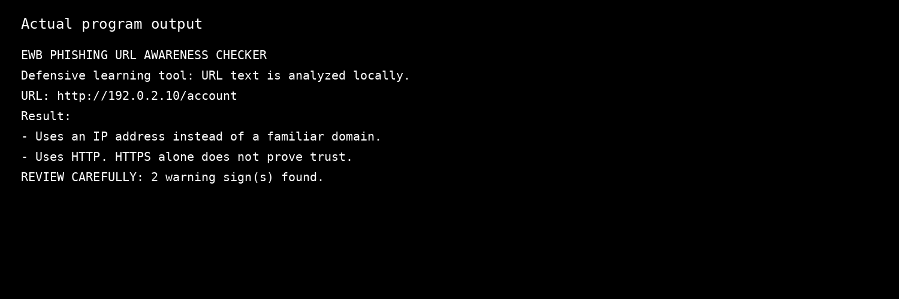
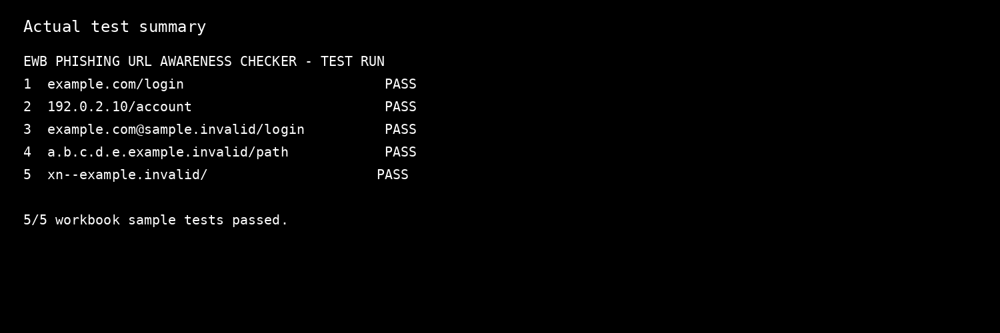

# EWB Phishing URL Awareness Checker

## Overview

Phishing is a social-engineering technique where a message or link is designed to make someone reveal information or take an unsafe action. This educational tool checks URL text for common warning signs without opening the link.

The checker is a **text-only defensive tool**. It does not visit websites, scan pages, collect credentials, or prove that a URL is safe.

## Features

- Detects an `@` symbol in the URL.
- Flags unusually long URLs (over 100 characters).
- Flags IP-address hostnames.
- Flags many hostname segments (5 or more).
- Flags punycode-style hostnames containing `xn--`.
- Flags the HTTP scheme.
- Handles malformed URL input without crashing.
- Gives a short explanation for each warning.
- **Improvement 1:** accepts multiple comma-separated URLs in one run.
- **Improvement 2:** prints a warning summary and explains why each finding matters.

## Requirements

- Python 3.10 or later.
- No extra packages are required.

## How to Run

```bash
python phishing_checker.py
```

On systems where Python 3 is named separately:

```bash
python3 phishing_checker.py
```

## Example Output

```text
URL: http://192.0.2.10/account
Result:
- Uses an IP address instead of a familiar domain.
- Uses HTTP. HTTPS alone does not prove trust.

REVIEW CAREFULLY: 2 warning sign(s) found.
```

## Testing

The five workbook sample strings were tested exactly as provided.

| # | Input | Expected | Actual | Result |
|---|---|---|---|---|
| 1 | `https://www.example.com/login` | No warning signs | No listed warning signs found. This does NOT prove safety. | PASS |
| 2 | `http://192.0.2.10/account` | IP address + HTTP | IP address + HTTP warnings shown. | PASS |
| 3 | `http://example.com@sample.invalid/login` | @ symbol + HTTP | @ symbol + HTTP warnings shown. | PASS |
| 4 | `https://a.b.c.d.e.example.invalid/path` | Many hostname segments | Many hostname segment warning shown. | PASS |
| 5 | `https://xn--example.invalid/` | Punycode-style hostname | Punycode-style hostname warning shown. | PASS |

Detailed test evidence is in `tests/test_samples.md`.

## Screenshots





## Improvements

### 1. Multiple URL input

The original learning flow focuses on one URL at a time. This version accepts multiple comma-separated URLs in one run, so the user does not need to restart the program for every sample.

### 2. Safer handling and explanations

Malformed URL input is handled with a clear message instead of a crash. The program also prints a short explanation for each warning, making the tool easier to understand during review.

## Limitations

This is an educational tool. It only reads URL text. It does not visit URLs, scan for malware, check reputation databases, or prove that a URL is safe. No warning signs found does **not** mean a URL is safe.

The six checks are clues rather than proof. Legitimate URLs can trigger some warnings, and malicious URLs can avoid these simple checks.

## Ethical Use

Use the supplied sample strings or other harmless test strings. Do not collect credentials. Do not use this project to deceive anyone or to test websites without permission.

## Author

Naveen M  
AI Powered Cybersecurity Internship  
EWB Courses
